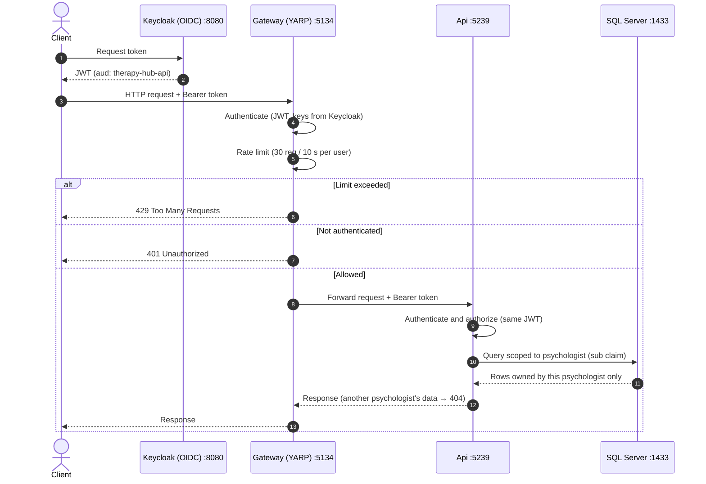

# TherapyHub

A system for psychologists to manage patients, appointments, and clinical records.

Each psychologist sees only their own patients. Clinical data is treated as sensitive personal data under LGPD
(Lei 13.709/2018, art. 11), and record keeping follows CFP Resolution 001/2009 and the Psychologist's Code of Ethics.

> **Status:** early development. Patient registration and lookup work end to end. Appointments and clinical records
> are planned.

## Technology stack

| Area                 | Technology                                                                                       |
| -------------------- | ------------------------------------------------------------------------------------------------ |
| Runtime              | .NET 11, C# (latest), nullable enabled, warnings as errors                                       |
| API                  | ASP.NET Core Minimal APIs, REPR endpoints in feature groups, OpenAPI, ProblemDetails             |
| Validation           | FluentValidation                                                                                 |
| Persistence          | EF Core 11, SQL Server 2022                                                                      |
| Gateway              | YARP reverse proxy, per-user rate limiting                                                       |
| Identity             | Keycloak 26 (OIDC, JWT bearer tokens)                                                            |
| Encryption           | ASP.NET Core Data Protection (production keys in Azure Blob Storage, wrapped by Azure Key Vault) |
| Tests                | xUnit, NSubstitute, WebApplicationFactory, Testcontainers (SQL Server)                           |
| Local infrastructure | Docker Compose                                                                                   |

## Architecture

The solution uses Clean Architecture with Domain-Driven Design. Dependencies point inward: the Domain depends on
nothing, and outer layers depend on inner ones.

```text
          ┌────────────────────────────────────────────┐
          │ Api (composition root, endpoints, auth)    │
          │   ┌────────────────────────────────────┐   │
          │   │ Infrastructure (EF Core, repos,    │   │
          │   │ encryption, domain event dispatch) │   │
          │   │   ┌────────────────────────────┐   │   │
          │   │   │ Application (use cases,    │   │   │
          │   │   │ ports, DTOs)               │   │   │
          │   │   │   ┌────────────────────┐   │   │   │
          │   │   │   │ Domain (aggregates,│   │   │   │
          │   │   │   │ value objects,     │   │   │   │
          │   │   │   │ events, errors)    │   │   │   │
          │   │   │   └────────────────────┘   │   │   │
          │   │   └────────────────────────────┘   │   │
          │   └────────────────────────────────────┘   │
          └────────────────────────────────────────────┘
```

| Project                     | Responsibility                                                                                                                               |
| --------------------------- | -------------------------------------------------------------------------------------------------------------------------------------------- |
| `TherapyHub.Domain`         | Aggregates (e.g. `Patient`), strongly typed IDs, value objects (`Cpf`, `Email`), domain events, `Result`/`Error`. No dependencies.           |
| `TherapyHub.Application`    | Commands and queries with their handlers, ports such as `IPatientRepository`, `IUnitOfWork`, `ICurrentUser`, and DTOs.                       |
| `TherapyHub.Infrastructure` | `TherapyHubDbContext`, entity configurations, migrations, repositories, query services, encrypted column converter, domain event dispatcher. |
| `TherapyHub.Api`            | Minimal API host. One folder per use case (`Features/<Area>/<UseCase>/`) holding the endpoint, request, response, and validator.             |
| `TherapyHub.Gateway`        | YARP reverse proxy and the only public entry point. Validates the JWT and applies rate limits before forwarding to the API.                  |

### Request flow



- **Gateway:** validates the Keycloak token, applies a limit of 30 requests per 10 seconds per user (anonymous
  requests are partitioned by IP), then requires an authenticated user.
- **API:** validates the token again, so it never trusts the network. The psychologist ID comes from the token's
  `sub` claim. Data is always filtered by that ID, and another psychologist's records come back as `404`.

### Sensitive data handling

- Logs contain IDs only. They never contain patient names, documents, contact details, or clinical content.
- Clinical note content is encrypted at the application level with ASP.NET Core Data Protection. Keys are kept
  out of the database and the repository. In production they live in Azure Blob Storage, wrapped by Key Vault. In
  development they live in a local folder. Losing the keys means losing the notes, so never rotate or delete keys
  by hand.
- Every access to a clinical record is audited (who, when, which record), with no clinical content.
- Seeds, tests, and examples use obviously fake data only.

## Running locally

### Prerequisites

- [.NET 11 SDK](https://dotnet.microsoft.com/download) (see `global.json`)
- Docker (Docker Desktop on Windows/macOS)
- PowerShell 7+ (`pwsh`) for the Keycloak setup script

### 1. First-time setup

```bash
# Restore local tools (dotnet-ef)
dotnet tool restore

# Create your local environment file, then fill in the three passwords
cp .env.example .env
```

`.env` holds `MSSQL_SA_PASSWORD`, `KEYCLOAK_ADMIN_PASSWORD`, and `KEYCLOAK_DEV_USER_PASSWORD`. SQL Server requires
at least 8 characters with uppercase, lowercase, a digit, and a symbol. `.env` is git-ignored. Never commit it.

```bash
# Start SQL Server (:1433) and Keycloak (:8080)
docker compose up -d

# Create the therapy-hub realm, the API and dev clients, the audience mapper, and the fake user dev.psychologist
pwsh ./infra/keycloak/setup.ps1

# Store the connection string in user-secrets (use the SA password from .env)
dotnet user-secrets set ConnectionStrings:TherapyHub "Server=localhost,1433;Database=TherapyHub;User Id=sa;Password=<from .env>;TrustServerCertificate=true" --project src/TherapyHub.Api

# Create the database schema
dotnet ef database update --project src/TherapyHub.Infrastructure --startup-project src/TherapyHub.Api
```

### 2. Run the services

Use two terminals:

```bash
dotnet run --project src/TherapyHub.Api        # http://localhost:5239 (internal, behind the gateway)
dotnet run --project src/TherapyHub.Gateway    # http://localhost:5134 (clients call this one)
```

In development the API serves its OpenAPI document at `http://localhost:5239/openapi/v1.json`. Both services expose
an anonymous `/health` endpoint.

### 3. Get a token and call the API

The `therapy-hub-dev` client allows the password grant. It is for local development only.

```bash
TOKEN=$(curl -s -X POST http://localhost:8080/realms/therapy-hub/protocol/openid-connect/token \
  -d grant_type=password \
  -d client_id=therapy-hub-dev \
  -d username=dev.psychologist \
  -d "password=<KEYCLOAK_DEV_USER_PASSWORD from .env>" | jq -r .access_token)

# Register a patient (fake data only)
curl -i -X POST http://localhost:5134/patients \
  -H "Authorization: Bearer $TOKEN" \
  -H "Content-Type: application/json" \
  -d '{"fullName":"Test Patient","email":"test.patient@example.com","cpf":null,"birthDate":null}'

# Fetch it back using the id from the Location header
curl -H "Authorization: Bearer $TOKEN" http://localhost:5134/patients/<id>
```

### Development commands

```bash
dotnet build                          # build the solution (must have 0 warnings)
dotnet test                           # all tests; API integration tests need Docker running
dotnet format --verify-no-changes     # format check (must pass)

# EF Core migrations (always pass both projects)
dotnet ef migrations add <Name> --project src/TherapyHub.Infrastructure --startup-project src/TherapyHub.Api --output-dir Persistence/Migrations
```

| Test project                          | Scope                                                             |
| ------------------------------------- | ----------------------------------------------------------------- |
| `TherapyHub.Domain.Tests`             | Aggregates and value objects                                      |
| `TherapyHub.Application.Tests`        | Use case handlers with substituted ports                          |
| `TherapyHub.Api.IntegrationTests`     | HTTP endpoints against a real SQL Server in Testcontainers        |
| `TherapyHub.Gateway.IntegrationTests` | Gateway auth and rate limiting against a stub backend (no Docker) |

## Conventions

- NuGet versions live only in `Directory.Packages.props` (central package management). Shared build settings live in
  `Directory.Build.props`.
- All text files use LF line endings.
- No secrets in `appsettings*.json` or anywhere in the repository. Use user-secrets, environment variables, or `.env`.
- Contributor and agent rules are in [AGENTS.md](AGENTS.md).
